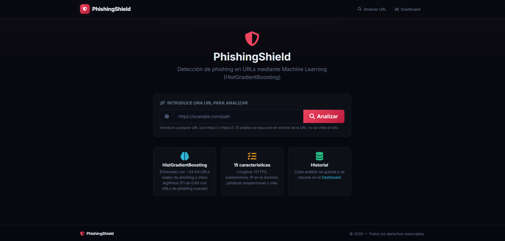
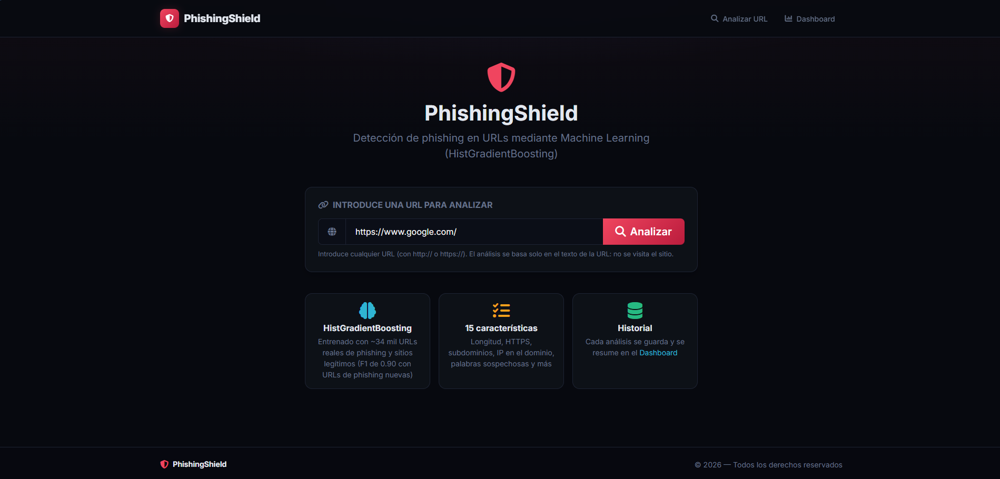
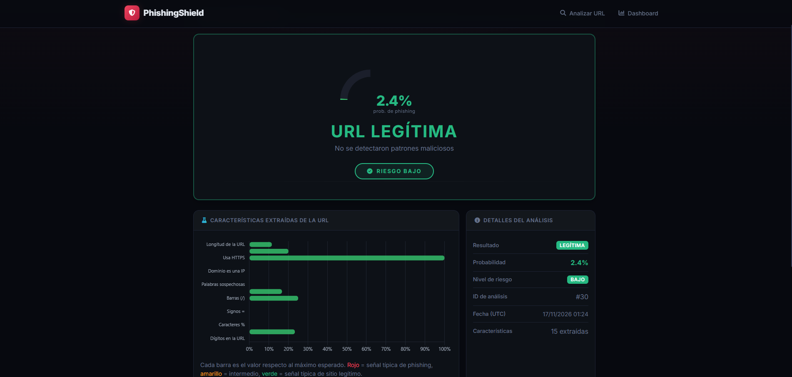
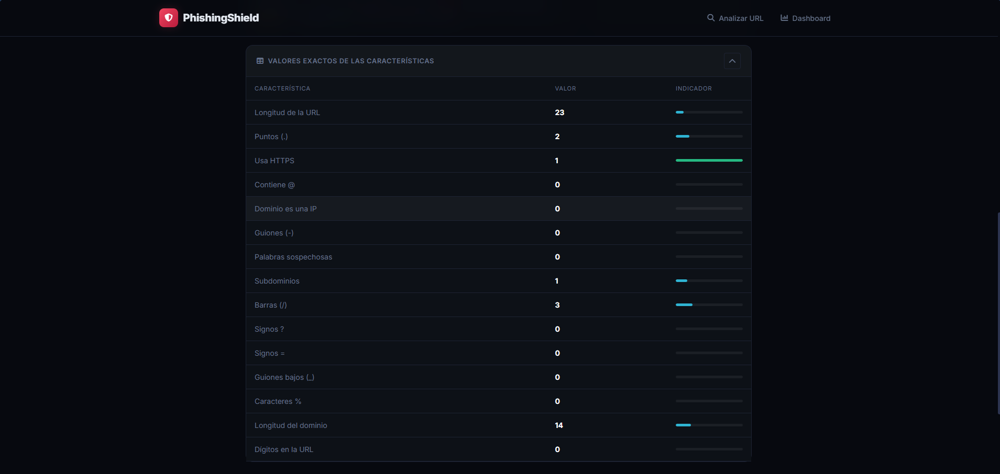
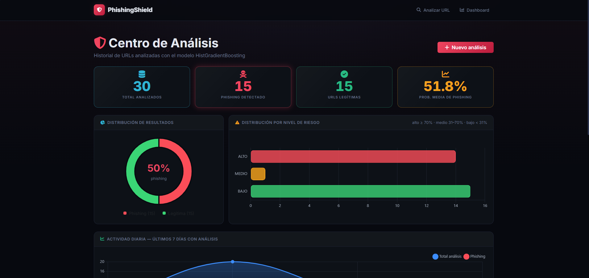
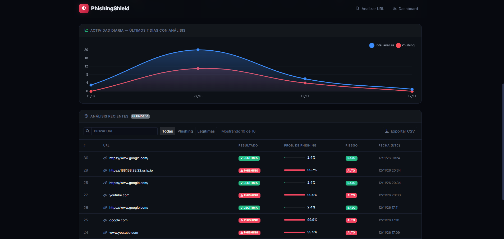
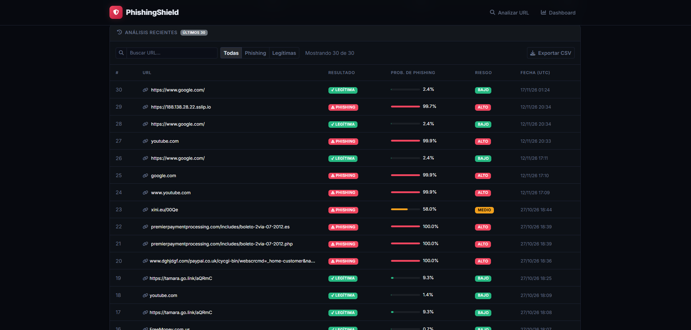
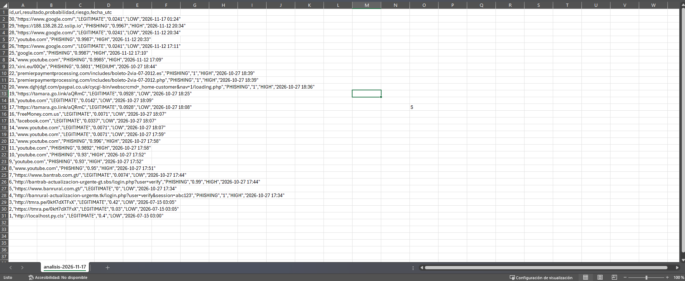
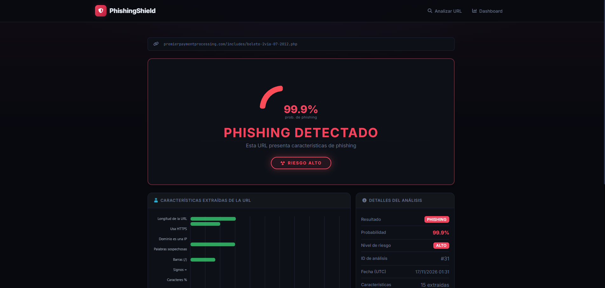
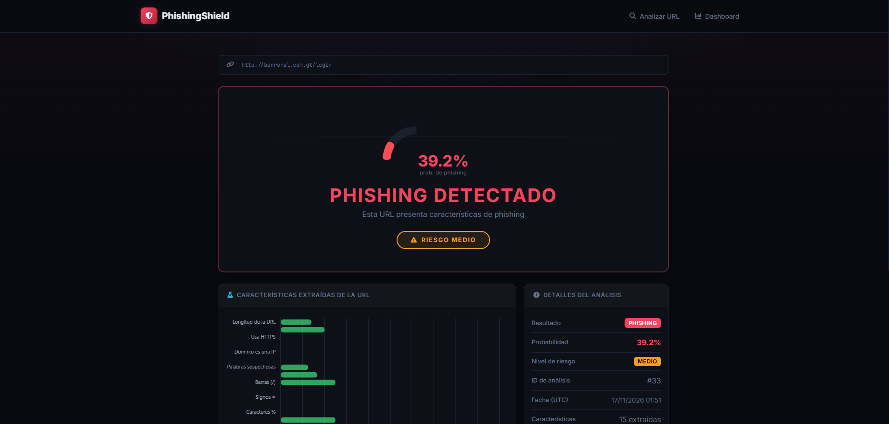

# Detección de phishing con aprendizaje automático: sistema web de análisis y visualización de resultados

Trabajo de graduación — Universidad del Valle de Guatemala, Facultad de Ingeniería.

## Descripción

Sistema web que analiza una URL y estima la probabilidad de que sea phishing. La aplicación web (ASP.NET Core MVC) recibe la URL, la envía a un microservicio (FastAPI) que extrae 15 características de la URL y las evalúa con un modelo de aprendizaje automático, y guarda cada análisis en PostgreSQL. Incluye un dashboard con el historial y las estadísticas de los análisis.

El modelo en producción es HistGradientBoosting, elegido tras comparar seis clasificadores. El detalle del modelo, los conjuntos de datos y la evaluación está en [`src/README.md`](src/README.md) y en el informe final.

## Tecnologías

- ASP.NET Core MVC (.NET 8) y Entity Framework Core
- Python 3.12, FastAPI y scikit-learn
- PostgreSQL 16
- Chart.js y Bootstrap
- Docker y Docker Compose

## Requisitos previos

Con Docker (recomendado):

- Docker Desktop con Docker Compose

Sin Docker:

- .NET SDK 8
- Python 3.12
- PostgreSQL 16

## Instalación

1. Clonar el repositorio y entrar a la carpeta del código:

   ```bash
   git clone https://github.com/GraduacionesUVG/2026-191002-quezada-soler-jose-alfredo.git
   cd 2026-191002-quezada-soler-jose-alfredo/src
   ```

2. Crear el archivo de variables de entorno a partir del ejemplo y completar el usuario y la contraseña de la base de datos:

   ```bash
   cp .env.example .env
   ```

3. Construir y levantar los servicios:

   ```bash
   docker compose up --build
   ```

### Instalación sin Docker

1. Microservicio de IA:

   ```bash
   cd src/phishing_ai
   python -m venv .venv
   .venv\Scripts\activate
   pip install -r requirements.txt
   uvicorn main:app --port 8000
   ```

2. Base de datos: crear una base de datos `phishing_db` en PostgreSQL. Las tablas se crean al iniciar la aplicación web.

3. Aplicación web: colocar la cadena de conexión en `src/PhishingDetector/appsettings.Development.json` y ejecutar:

   ```bash
   cd src/PhishingDetector
   dotnet run
   ```

## Ejecución

Con los servicios levantados:

| Servicio | URL |
|---|---|
| Aplicación web | http://localhost:5000 |
| Dashboard | http://localhost:5000/Dashboard |
| API del microservicio | http://localhost:8000/docs |

Para detener los servicios:

```bash
docker compose down
```

## Capturas

Las capturas del sistema están en [`/capturas`](capturas).

| | |
|---|---|
|  |  |
|  |  |
|  |  |
|  |  |
|  |  |

## Demo

Video demostrativo: [`demo/demo.mp4`](demo/demo.mp4)

## Documentación

Informe final: [`docs/informe_final.pdf`](docs/informe_final.pdf)

## Consentimiento firmado

Consentimiento de uso de foto y video: [`docs/consentimiento_firmado.pdf`](docs/consentimiento_firmado.pdf)

## Autor

José Alfredo Quezada Soler — Carné 191002

Asesora: M.Sc. Lynette García
